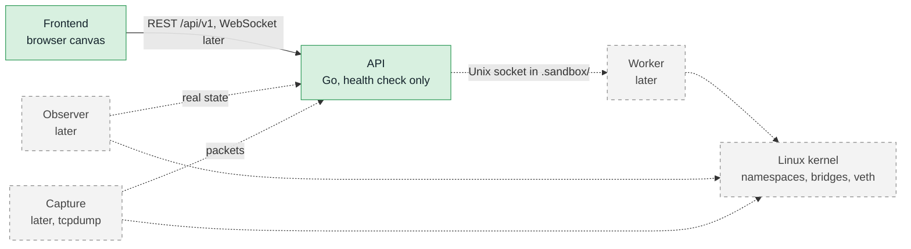

# NetLab

NetLab lets you draw a Linux network lab in your browser, check it for mistakes, and later deploy it on your machine. A lab is one drawing: a set of network namespaces (small, isolated hosts), Linux bridges (virtual switches), and the links between them.

It is for people who learn or test Linux networking and want to build a topology without typing long `ip` commands.

## Milestone 1

What works now:

- Draw a lab on the canvas: drag namespaces and bridges in and link them.
- Edit nodes, interfaces, addresses, routes, bridges, and links in the properties panel.
- Validate the lab and read the problems in the Issues tab. Clicking a problem selects the node or link.
- Save a lab to a `.netlab.json` file, open it again, or drop a file on the canvas.
- Start from an example lab in the Examples menu.

Not in Milestone 1: deploying a lab. The canvas edits a drawing only. Nothing is created on your machine.

## Architecture



Solid boxes exist in Milestone 1. Dashed boxes come in later milestones.

- **Frontend**: the browser canvas to draw, edit, validate, save, and open labs. Built.
- **API**: the HTTP API under `/api/v1`. In Milestone 1 it only answers a health check.
- **Worker**: does the privileged work (namespaces, bridges, links) inside the sandbox. Later.
- **Observer**: reads the real kernel state and reports it, so the canvas can show drift. Later.
- **Capture**: captures packets on a link with `tcpdump`. Later.

## Prerequisites

| Tool | Minimum | Check |
| --- | --- | --- |
| git | any recent | `git --version` |
| make | GNU make 4 | `make --version` |
| Node.js | 22.18 | `node --version` |
| npm | 10 | `npm --version` |
| Go | 1.26 | `go version` |

`unshare`, `ip`, and `nft` are needed only for the sandbox check below, not for the canvas. Linux is the supported development system. The sandbox does not work on other systems.

## Quick start

Run these from the repository root.

```bash
make install-web
```

Start the API in one terminal (listens on `:8080`):

```bash
make dev-api
```

Start the frontend in another terminal (serves `http://localhost:5173`):

```bash
make dev-web
```

Open `http://localhost:5173`. You see an empty canvas. The toolbar shows **API online, worker offline** in amber. That is correct for Milestone 1: the worker does not exist yet, so the API reports it as unreachable. While the first check runs it says "Checking API".

Try it: drag two namespaces and a bridge from the left panel, drag from an interface handle to link them, press **Validate**, then **Save**.

## Troubleshooting

- **"API offline" (red)**: the API is not running. Start `make dev-api`. The frontend alone still works for the canvas, editing, validating, saving, opening, and examples.
- **Amber "API online, worker offline"**: expected in Milestone 1 (see above).
- **Port 5173 is busy**: the dev server stops with an error, because the port is fixed. Free the port, or run `npm run dev -- --port <free port>` from `web`.
- **Do not change the API port in Milestone 1.** The dev server forwards `/api` to `localhost:8080`.

## Safety and sandbox

Nothing in Milestone 1 needs root, and no command in this README uses `sudo`.

Code that creates namespaces, bridges, and links changes the network of the machine it runs on. NetLab runs that code only inside a throwaway sandbox: a private user, network, and mount namespace started by `scripts/sandbox.sh`. Only the worker runs there. Lab traffic never reaches your real network, and everything disappears when the sandbox exits. Read [docs/sandbox.md](docs/sandbox.md) for the full design.

Check your machine from the repository root:

```bash
scripts/check-env.sh
```

A pass prints `ok` for each tool, then `ok` for `bridge`, `veth pair`, and `named namespace`, and exits with code 0. If it fails on user namespaces, follow the remediation text on the sandbox page.

## Project layout

- `web/`: the frontend (React, TypeScript, Vite).
- `api/`: the Go API, the worker, and small tools.
- `docs/`: sandbox, decisions, links, and the topology schema.
- `examples/`: ready-made labs for the Examples menu.
- `scripts/`: sandbox and environment-check scripts.
- `specs/`: feature specs and plans.
- `testdata/`: shared validator test cases.
- `TICKETS/`: work tickets.
- `Makefile`: the common commands.

## Checks

Run these from the repository root. Every command here is run on a clean checkout before each milestone is closed.

| Check | Command | Pass looks like |
| --- | --- | --- |
| Build | `make build` | the frontend prints "built in …ms", the Go build prints nothing, exit 0 |
| Lint and format | `make lint` | ESLint prints nothing, Prettier says "All matched files use Prettier code style!", gofmt and vet print nothing, exit 0 |
| Validator cases | `node web/scripts/checkVectors.ts` | every line is `ok`, then a `speed:` line, exit 0 |
| Example labs | `node web/scripts/checkExamples.ts` | each example `ok`, the `bad input` lines `ok`, a `speed:` line, exit 0 |
| Environment | `scripts/check-env.sh` | each tool `ok`, plus `bridge`, `veth pair`, `named namespace`, exit 0 |
| Sandbox integration | `make sandbox-test` | Go packages print `[no test files]`, exit 0 (normal for now) |

Automated frontend unit tests and the end-to-end browser test (`make test-web`, `make e2e-web`) are not available yet.

## More docs

- [docs/sandbox.md](docs/sandbox.md): how the sandbox works and its limits.
- [docs/decisions.md](docs/decisions.md): the project decisions and why.
- [docs/links.md](docs/links.md): how links between interfaces work.
- [docs/topology.schema.json](docs/topology.schema.json): the lab file format.
